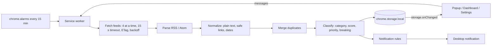

# MarketPulse

A Chrome extension (Manifest V3) that collects financial market news from free public RSS feeds, sorts it into 11 categories, ranks every headline with transparent keyword rules, merges the same story from different publishers, and sends a desktop notification when something important is published.

No server, no paid API, no account, no build step: plain JavaScript modules, Chrome storage and Chrome alarms.

> MarketPulse ranks headlines. It does not predict market moves and is not investment advice.

## Features

- **24 default feeds**: CNBC, MarketWatch, Investing.com, CoinDesk, Cointelegraph, BBC Business, FXStreet, OilPrice.com, the Federal Reserve, the ECB, the Bank of England, US BEA, The Daily Star, The Business Standard, Dhaka Tribune and Prothom Alo English (off by default). Add, test, turn off or remove any feed.
- **11 categories**: Global Economy, Stock Market, Forex, Cryptocurrency, Gold & Silver, Oil & Energy, Central Banks & Interest Rates, Inflation & Employment, Corporate Earnings, Geopolitical & Trade, Bangladesh Economy.
- **Importance score, priority and breaking flag** for every story, with the matched keywords shown ("Why: rate hike, inflation · score 16").
- **Duplicate detection**: the same link is stored once; the same story from another publisher is merged into the first report ("+2 sources") and scores higher.
- **Desktop notifications** for high-priority stories, your own "always alert" keywords, per-category switches, one alert per story or one summary per refresh. Never the same story twice. Clicking opens the article.
- **Dashboard** with breaking strip, top stories, filters, search, bookmarks and statistics. **Popup** with the important stories of the last 24 hours. Dark and light themes.

## Install locally

1. Download or clone this repository.
2. Open `chrome://extensions`.
3. Turn on **Developer mode** (top right).
4. Click **Load unpacked** and choose the folder that contains `manifest.json`.
5. Pin MarketPulse from the puzzle-piece menu so its icon stays in the toolbar.

On install, MarketPulse fetches every feed once **without** notifying (otherwise you would get hundreds of old headlines). From then on it checks every 15 minutes and notifies you about new important stories. Requires Chrome 120 or later.

To update after pulling new code, click the reload arrow on the MarketPulse card in `chrome://extensions`.

## How it works



| Folder | What is in it |
| --- | --- |
| `src/config/` | Default feeds, categories, importance keywords, default settings and validation. Edit `feeds.js` to change the default sources. |
| `src/core/` | Pure logic with no Chrome calls: XML reader, feed parser, normalizer, keyword matcher, classifier, deduper, retention, notification rules, backup. |
| `src/services/` | Thin wrappers around Chrome APIs: storage, fetcher, refresh pipeline, notifications. |
| `src/background.js` | Service worker: alarms, install/startup, messages, notification clicks. |
| `src/ui/` | Dashboard, popup and settings pages, plus shared tokens, DOM helper and icons. |

### Scoring

```
score = Σ keyword weight × (2 if in the headline, 1 if only in the summary)
        × feed weight (1.5 for official central bank and statistics feeds)
      + 2 per other publisher with the same story (max 3)
      + your own keyword weights

high ≥ 8, medium ≥ 4 (both configurable)
breaking = published in the last hour AND (high priority, or an urgent phrase like
           "breaking" / "halted", or reported by 3+ publishers)
```

Rate decisions, CPI, payrolls and GDP weigh the most. Institution names ("Federal Reserve", "ECB") weigh little, because they appear in every routine notice those institutions publish. Weights were tuned on 642 real headlines: about 8% come out high.

**Category**: Bangladesh wins when the feed is a Bangladesh source or the headline names a Bangladesh keyword. Otherwise the first topic word in the headline decides, then the feed's category.

### Feeds that do not work, and why

| Source | Problem | Instead |
| --- | --- | --- |
| Yahoo Finance | Old RSS endpoints return 404 / 429 | CNBC, MarketWatch |
| US BLS (CPI, jobs) | 403 for automated readers | BEA feed, Investing.com Economic Indicators |
| IMF | 403 | Try adding it yourself; the Test button shows whether it works for you |
| Bangladesh Bank | No RSS feed | Bangladesh business feeds |
| Kitco | No RSS feed | Investing.com Commodities, FXStreet |
| MarketWatch MarketPulse | Feed is stale (newest item from 2025) | MarketWatch Top Stories |

FXStreet and the Bank of England refuse *headless* automated browsers, so they return 403 in a plain live test run; in a visible browser (`npm run test:live -- --headed`) and in normal Chrome they work. Investing.com sends dates without a time zone; MarketPulse reads them as UTC (verified against the live feed). RSS only carries the headline and a short summary; the full article opens on the publisher's site, and paywalls are not bypassed.

### Permissions

| Permission | Why |
| --- | --- |
| `storage` | Articles, bookmarks, settings, feed health |
| `alarms` | Refresh every N minutes, even after Chrome stops the service worker |
| `notifications` | Desktop alerts |
| Host access to the default feed sites only | Fetch those feeds |
| Optional host access | Asked for one site at a time when you add a feed, and given back when you remove it |

## Limits worth knowing

- **Not real time.** Alerts arrive one refresh after the publisher updates its feed (15 minutes by default, 5 at the fastest). Real-time push would need a server.
- **Only while Chrome runs.** Alarms do not fire when Chrome is closed; MarketPulse refreshes when Chrome starts again.
- **Keyword rules have limits.** They cannot read negation ("no recession expected" still matches "recession") or unusual wording. The "Why" line shows exactly what matched, and you can tune thresholds and add your own keywords.
- **Similar-headline matching is conservative.** It merges only clearly matching headlines from different publishers, so the same story worded very differently can appear twice.
- **Feeds change without notice.** Settings shows each feed's health and has a Test button.

## Tests

```bash
npm install
npm test            # 289 unit tests (node:test, no other packages)
npm run test:e2e    # 20 Playwright tests that load the unpacked extension in Chromium
npm run test:live   # downloads every real default feed in Chromium (needs internet); add -- --headed for all 24
```

Unit tests cover the XML reader, parser (with saved copies of every default feed), normalizer, dates, URLs, fetcher (timeouts, 304, size limit, charsets, backoff), classifier (20 real headlines), deduper (real duplicate and near-miss pairs), retention, notification rules, notification clicks, the refresh pipeline, settings validation, storage, backup and view filters. End-to-end tests serve generated feeds through Playwright routing, so they never depend on the real sites.

## Manual testing checklist

Load the extension, then:

1. **RSS fetching**: open the dashboard. Within a few seconds the header says "Updated just now" and the Statistics panel shows the feed count. In Settings, click **Test all feeds**: each feed shows HTTP status, item count and its latest headline.
2. **Categorization**: pick a category in the sidebar; check that the stories fit. Each story shows its category label and a "Why" line with the matched keywords.
3. **Duplicate detection**: look for stories with "+1 source" (hover it to see which publishers). The Statistics panel shows how many duplicates the last refresh merged.
4. **Desktop notifications**: in Settings, click **Send a test notification**. Then set "Show alerts for" to "Every new story", save, and wait for the next refresh (or click Refresh on the dashboard): new stories appear as notifications, and clicking one opens the article. If nothing appears, allow notifications for Google Chrome in your operating system settings.
5. **Bookmarks**: click the star on a story, reload the dashboard, open **Bookmarks**. Click the star again to remove it.
6. **Settings persistence**: change the refresh interval and theme, save, close and reopen Settings. Invalid values (for example 2 minutes) show an error and are not saved.
7. **Service worker scheduling**: open the service worker console (below) and run `await chrome.alarms.get('refresh')`. `periodInMinutes` matches your setting. Change the setting and run it again.

## Debugging with Chrome DevTools

- **Service worker**: `chrome://extensions` → MarketPulse → **service worker** link. Every refresh logs one line, for example `[MarketPulse:refresh] refresh (alarm): 21 ok, 0 unchanged, 2 failed, 12 new, 3 duplicates, 1 notified, 4626 ms`. Turn on **Settings → Advanced → Detailed logs** for debug output.
- **Inspect storage**: in the service worker console, `await chrome.storage.local.get(null)` shows everything; `(await chrome.storage.local.get('feedState')).feedState` shows each feed's last error and next retry.
- **Force a refresh**: from any MarketPulse page's console, `await chrome.runtime.sendMessage({ type: 'refresh' })` returns the refresh summary.
- **Network**: the service worker DevTools **Network** tab shows every feed request, including `304 Not Modified` answers.
- **Pages**: right-click the popup → **Inspect**; the dashboard and settings are normal tabs with DevTools.
- **Reset**: Settings → **Delete stored news** clears stories (bookmarks stay); the next refresh starts fresh without alerts.

## Feature checklist

| Feature | Status | Tested by |
| --- | --- | --- |
| Manifest V3, module service worker, minimal permissions | Done | `manifest.test.js`, every e2e test loads it |
| 24 configurable RSS sources, central config in `src/config/feeds.js` | Done | `config.test.js`, `real-feeds.test.js`, live test |
| Add / test / disable / remove / reset feeds, per-site permission | Done | `ui.spec.js` (test, toggle, invalid URL), manual for the permission prompt |
| RSS 2.0, RSS 1.0, Atom parsing; broken XML recovery | Done | `xml.test.js`, `feed-parser.test.js` |
| Safe HTML-to-text, safe links, missing/odd dates | Done | `text.test.js`, `url.test.js`, `normalizer.test.js` |
| Timeouts, size limit, ETag/304, backoff, failed feed recovery | Done | `feed-fetcher.test.js`, `feed-health.test.js`, live 304 test |
| 11 categories, keyword scoring, priority labels, breaking | Done | `classifier.test.js`, `keyword-matcher.test.js` |
| Custom keywords with weights and always-alert | Done | `classifier.test.js`, `notify-rules.test.js`, `ui.spec.js` |
| Duplicate URLs and similar headlines merged | Done | `deduper.test.js`, `background.spec.js` |
| chrome.alarms scheduling, configurable interval | Done | `background.spec.js`, `ui.spec.js` |
| Notifications: on/off, per category, each/digest, never twice, click opens article | Done | `notify-rules.test.js`, `notification-service.test.js`, `background.spec.js` |
| Silent first run | Done | `refresh-service.test.js`, `background.spec.js` |
| Dashboard: header, overview, feed, filters, search, bookmarks, statistics | Done | `ui.spec.js`, `news-view.test.js` |
| Popup | Done | `ui.spec.js` |
| Settings page with validation; JSON backup | Done | `ui.spec.js`, `settings.test.js`, `backup.test.js` |
| Storage limits and retention | Done | `retention.test.js`, `refresh-service.test.js` |
| Dark / light theme | Done | `ui.spec.js` |
| Logging for debugging | Done | `log.test.js` |
| Real desktop notification visible on your screen | Manual | Checklist step 4 (automated tests check `chrome.notifications.getAll`) |

## License

MIT
